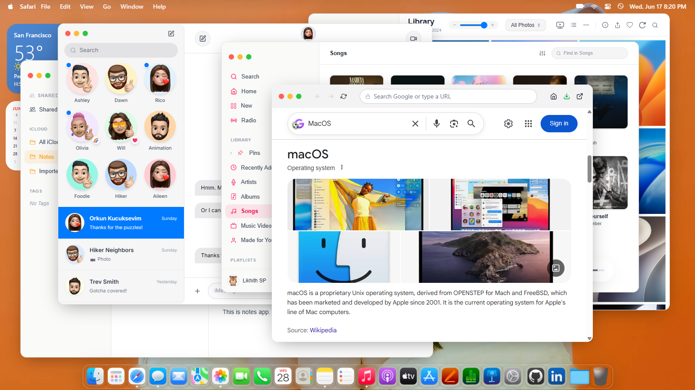

# macOS Web Simulator

A fully interactive macOS-style desktop that runs in the browser. It includes a first-boot setup, lock screen, draggable and resizable app windows, a working Dock, a menu bar, and a set of built-in apps (Finder, Safari, Notes, Photos, Music, Settings, Terminal-like utilities and more).

> Fan-made project for learning and fun. Not affiliated with or endorsed by Apple Inc.



## Features

- **Boot & lock screen** — power-on animation, lock screen with clock, password unlock and auto-lock after 1 minute of inactivity
- **First-run setup** — language, region, keyboard, time zone, privacy and account creation, stored in `localStorage`
- **Desktop environment** — draggable/resizable windows, desktop icons, wallpapers and light/dark mode
- **Dock** — hover magnification, running-app indicators and launch bounce
- **Menu bar** — app menus, Apple menu (sleep, restart, shut down), Control Center and live clock
- **Finder** — simulated file system with Desktop, Documents, Downloads and Pictures
- **Safari** — embedded browser with navigation controls
- **Notes** — Apple Notes-style editor with folders, search and autosave
- **Photos** — gallery with the ability to set any image as the wallpaper
- **Music** — local playlist player with lock-screen controls
- **Minecraft** — a full Eaglercraft build running inside its own window (offline-capable 1.8-style game, world saves in the browser)
- **Settings** — System Settings replica with "About This Mac"
- **Editable profile** — change the lock-screen name and avatar (saved in `localStorage`)

## Tech stack

React 19 · Vite 7 · Tailwind CSS 4 · Framer Motion · GSAP · Radix UI · React RND · Zustand · Lucide

## Requirements

- [Node.js](https://nodejs.org/) **20.19+** (or 22.12+)
- npm

## Run locally

```bash
npm install
npm run dev
```

Open the URL printed in the terminal (usually <http://localhost:5173>).

To test the production build:

```bash
npm run build
npm run preview
```

### Resetting the simulator

All simulator state (setup, account, notes, wallpapers, window layout) is kept in the browser's `localStorage`. To start from a clean boot, open DevTools → Application → Local Storage and delete the entries for the site, then reload.

## Deploy to GitHub Pages

This repository ships with `.github/workflows/deploy.yml`. Once the code is on GitHub:

1. Go to **Settings → Pages** and set **Source** to **GitHub Actions**.
2. Push to `main` (or run the workflow manually from the **Actions** tab).
3. The site is published at `https://<your-username>.github.io/<repository-name>/`.

The workflow builds with `PUBLIC_BASE_PATH=/<repository-name>/`, so the app also works from a sub-path. If you host it at a domain root (Vercel, Netlify, your own server), just run `npm run build` — the default base is `/`.

## Project structure

```
src/
├── App.jsx                  # Boot → setup → lock screen → desktop state machine
├── app/                     # Individual apps (Finder, Safari, Notes, Photos, Music, …)
├── components/              # Shared UI (AppWindow, Dock, TopBar, widgets, glass effects)
├── layouts/                 # Desktop, lock screen, power screen and setup screens
├── constants/               # Wallpapers and playlist data
├── store/Appstore.js        # Zustand store for windows, theme and playback
└── index.css                # Tailwind entry point
public/
├── Wallpaper/               # Desktop and lock-screen wallpapers
├── icons/                   # Dock and app icons
├── games/                   # Eaglercraft (Minecraft) HTML build
└── images/                  # Gallery and profile images
```

## Minecraft (Eaglercraft)

Open **Minecraft** from the Dock or Launchpad. The game runs inside a normal app window and saves worlds in the browser.

- Click inside the game to capture the mouse; press `Esc` to release it.
- If the mouse does not get captured (some browsers block pointer lock inside frames), use **Capture mouse**, **Fullscreen**, or **New tab** in the bottom-right corner of the window.

## Credits

Based on [MacOS-Web-Simulator](https://github.com/LikhithSP/MacOS-Web-Simulator) by [LikhithSP](https://github.com/LikhithSP). App icons are loaded from the macOS Icons project and Wikimedia Commons; wallpapers and music belong to their respective owners and are included for demonstration purposes only.

## License

[MIT](LICENSE)
